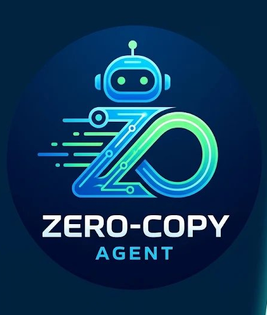
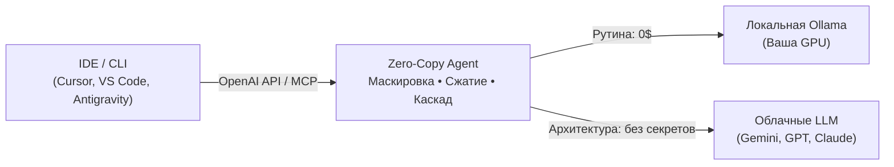

<div align="center">

<br/>

# Zero-Copy Agent

### Локальный LLM-шлюз и каскадный оркестратор для редакторов кода. Экономит токены, прячет пароли и подключается к IDE в один клик.

[](https://github.com/solyanni4/zero-copy-agent/releases/latest)
[](https://opensource.org/licenses/MIT)
[](#)
[](#)
[](#)

**Русская версия** • [English Guide](README_EN.md) • [Roadmap](ROADMAP.md) • [Пульт управления (локально)](http://127.0.0.1:8000/)

</div>

---

> **Простыми словами:**  
> Когда вы пишете код в **VS Code**, **Cursor**, **Windsurf** или **Antigravity**, платные нейросети с каждым запросом сжигают бюджет, а в промпты легко случайно слить пароли от баз данных, приватные IP или ключи из `.env`.  
> **Zero-Copy Agent** работает прямо на вашем компьютере: перехватывает запросы до выхода в сеть, вырезает пароли, сжимает длинный контекст и отправляет рутинные задачи на вашу локальную видеокарту (Ollama), оставляя платным облачным моделям только сложную архитектуру.



---

## Зачем это нужно

| Без программы | С Zero-Copy Agent |
| :--- | :--- |
| Счета за токены растут даже при мелких правках и генерации тестов | **Экономия 40–70%**: контекст сжимается, а черновой код пишет локальная модель без оплаты за токены |
| Риск случайно отправить в облако `.env`, пароли от БД или внутренние IP | **Локальная маскировка**: секреты подменяются метками до отправки и возвращаются на место в готовом коде |
| Одна модель на все задачи — либо слишком дорого, либо недостаточно умно | **Умный каскад (`cascade:architect`)**: сильная модель проектирует план, быстрая локальная пишет реализацию |
| Ручная правка JSON-файлов под каждый редактор и риск сломать конфиг | **Подключение в один клик**: программа сама находит IDE, настраивает порты и делает бэкап старых настроек |
| Непонятно, куда уходят лимиты API и почему кончились квоты | **Прозрачный пульт управления**: счетчик экономии в долларах, контроль лимитов RPM/TPM и ротация ключей |

---

## Что внутри

### Каскадный конвейер с локальным контролем качества
В режиме `cascade:architect` запрос проходит через замкнутый цикл:
1. **Проектирование:** флагманская модель формирует архитектурный план и сигнатуры функций с учетом релевантных паттернов из Базы решений.
2. **Локальная реализация:** локальная модель на вашей видеокарте пишет черновой код.
3. **Жесткий синтаксический шлюз (Local Hard Gate):** агент локально парсит AST и проверяет синтаксис. Если допущена ошибка — отправляет код на доработку без расхода платных токенов (до 2 циклов реворка).
4. **Аудит архитектора:** сильная модель проверяет только итоговый diff, а не всю простыню кода. При успешном аудите решение автоматически сохраняется в локальную Базу решений.

### База решений Архитектора (Локальный RAG + FTS5)
Успешные реализации и паттерны, прошедшие строгий синтаксический и архитектурный контроль, автоматически попадают в локальную базу `data/solutions.db` (SQLite WAL).
* **Мгновенный семантический поиск:** перед генерацией нового кода шлюз проверяет базу через FTS5 и векторные эмбеддинги Nomic (`nomic-embed-text`), подмешивая готовый проверенный контекст.
* **Управление в Web UI:** во вкладке «База решений» можно искать паттерны по коду и тегам, вручную добавлять свои шаблоны, редактировать их и копировать в один клик.

### Согласование сжатия промптов (Human-in-the-Loop)
При активной опции согласования движок не отправляет урезанный запрос вслепую, а показывает окно предпросмотра:
* Наглядная статистика: объем до и после сжатия, процент сэкономленных токенов.
* Возможность вручную скорректировать сжатый текст в редакторе перед отправкой.
* Кнопка **«На переделку»** с текстовым комментарием (например, «мягче», «жестче», «не убирай комментарии к типам»).
* Кнопки прямого действия: **«Одобрить и отправить»** или **«Отменить запрос»**.

### Сетапы оркестрации (Пресеты)
Вы можете быстро переключать характер работы агента прямо из шапки приложения:

| Пресет | Назначение | Архитектор / Исполнитель | Особенности |
|---|---|---|---|
| **Авто** (`auto`) | Сбалансированный режим | Gemini 4 Neon / Qwen 2.5 Coder 14B | Оценивает сложность задачи и распределяет нагрузку между локальным GPU и облаком |
| **Базовый** (`basic`) | Быстрые правки и черновики | Qwen 2.5 Coder 14B / Локальный GPU | Минимальные задержки, без тяжелого многоэтапного аудита |
| **МЫСЛИТЕЛЬ** (`thinker`) | Максимальная глубина и надежность | Gemini 4 Neon / Qwen 2.5 Coder 14B | Полная DAG-декомпозиция, RAG базы решений, кросс-ревью моделей и строгие AST-гейты |

В панели «Сетапы оркестрации» также доступен конструктор для создания собственных профилей под специфические задачи.

### Мастер подбора локальных моделей (Hardware Advisor)
Если вы хотите запускать модели локально без затрат на токены:
1. Нажмите кнопку **«Подбор»** в нижнем статус-баре.
2. Мастер автоматически определит модель вашей видеокарты, объем видеопамяти (VRAM), ОЗУ и ядра процессора.
3. Система предложит оптимальную модель под вашу конфигурацию:
   * **До 6 ГБ VRAM:** легкие модели `Qwen 2.5 Coder 3B / 7B (Q4)`;
   * **8 ГБ VRAM:** сбалансированные `Qwen 2.5 Coder 7B`, `DeepSeek Coder V2 Lite`;
   * **12 ГБ VRAM:** флагманский класс `Qwen 2.5 Coder 14B`, `DeepSeek R1 14B (Reasoning)`;
   * **16–24+ ГБ VRAM:** тяжелые `Qwen 2.5 Coder 32B`.
4. Скачивание запускается прямо из интерфейса с живой шкалой прогресса и активируется в один клик.

### Защита секретов и режим изоляции
Перед отправкой любого запроса встроенный фильтр находит:
* API-ключи (`sk-...`, `AIza...`, `ghp_...`);
* строки подключения к базам данных (`postgres://...`, `mongodb://...`);
* приватные IP-адреса подсетей `192.168.*`, `10.*`, `172.16.*`;
* токены авторизации и пароли.

Они заменяются на временные метки вида `__SEC_01_KEY__`. Модель генерирует код с метками, а шлюз восстанавливает исходные секреты перед показом в редакторе.  
Если включить тумблер **Air-Gap**, шлюз заблокирует любые исходящие вызовы во внешнюю сеть и принудительно переведет работу только на локальную Ollama.

### Распределение лимитов
Шлюз отслеживает минутные и дневные лимиты (RPM / TPM) по всем подключенным учетным записям. Если один ключ упирается в лимит, агент автоматически переключает следующий запрос на запасной аккаунт, предотвращая ошибки `429 Too Many Requests`.

### Нативная поддержка MCP
Агент работает не только как OpenAI-совместимый шлюз (`/v1/chat/completions`), но и как полноценный сервер Model Context Protocol (через SSE на `/sse` и JSON-RPC на `/mcp`). Это позволяет подключать его к Google Antigravity, Claude Desktop и Cursor в качестве поставщика инструментов.

---

## Быстрый запуск

### Вариант 1. Установка одной командой в консоли (рекомендуется)
Скрипт проверяет наличие Python, настраивает виртуальное окружение и запускает шлюз:

**Windows (PowerShell):**
```powershell
irm https://raw.githubusercontent.com/solyanni4/zero-copy-agent/main/install.ps1 | iex
```

**Linux / macOS:**
```bash
curl -sSL https://raw.githubusercontent.com/solyanni4/zero-copy-agent/main/install.sh | bash
```

### Вариант 2. Готовое приложение без консоли
Скачайте `zero-copy-agent.exe` (для Windows) или `zero-copy-agent-linux-x64` (для Linux) со страницы [Releases](https://github.com/solyanni4/zero-copy-agent/releases/latest).  
Приложение работает как обычная Windows-программа: открывает аккуратное окно управления, сворачивается в системный трей и не требует держать открытым черное окно терминала.

### Вариант 3. Docker (для серверов и Homelab)
```bash
git clone https://github.com/solyanni4/zero-copy-agent.git
cd zero-copy-agent
docker compose up -d
```

---

## Как начать работу

1. Запустите приложение и откройте локальный пульт управления: **[http://127.0.0.1:8000/](http://127.0.0.1:8000/)**.
2. Перейдите во вкладку **«Интеграции IDE»** и нажмите **«Подключить»** напротив установленного редактора:
   * **Google Antigravity** (автонастройка MCP и CLI-конфигов);
   * **Cursor** (подключение через MCP SSE);
   * **VS Code** (настройка расширения Continue);
   * **Windsurf** (Codeium MCP);
   * **Claude Desktop** (конфигурация инструментов).
3. Старый конфиг редактора автоматически копируется в резервную папку. При необходимости его можно вернуть одной кнопкой **«Откатить бэкап»**.
4. Выберите нужную модель в чате вашей среды и работайте в привычном ритме.

### Готовые режимы маршрутизации
* `cascade:architect` — двухэтапный каскад с жестким синтаксическим контролем и аудитом.
* `tier:local-fast` — генерация кода на локальной видеокарте через Ollama с нулевой стоимостью токенов.
* `gemini-4-neon` / `gpt-4o` — прямая работа с флагманскими моделями для глубокого анализа и нестандартных задач.

---

## Прозрачность и безопасность данных

* Все вычисления, маскировка данных и локальные проверки выполняются строго на вашей машине (`127.0.0.1`).
* Статистика сессий и лог маскирования сохраняются в локальную базу SQLite WAL. Данные не передаются внешним системам аналитики.
* В пульте управления наглядно отображаются исходный размер промпта, объем после сжатия и сумма сэкономленных средств.

---

## Участие в проекте

Если вы нашли ошибку или хотите предложить улучшение:
* Создайте [Issue на GitHub](https://github.com/solyanni4/zero-copy-agent/issues) с описанием проблемы.
* Если проект помог оптимизировать расходы на API — поддержите репозиторий звездой ⭐, это помогает развивать инструмент.

---

## Лицензия

Распространяется под свободной лицензией **MIT**.  
Автор: **Сергей Солянников ([Solyanni4](https://github.com/solyanni4))**

---

## Отказ от ответственности (Disclaimer)

* **Независимый проект:** `zero-copy-agent` не является официальным продуктом и не аффилирован с компаниями OpenAI, Google, Anthropic, DeepSeek, Alibaba Cloud, xAI или JetBrains. Все товарные знаки принадлежат их законным правообладателям.
* **Условия использования сервисов (ToS):** Пользователь несет личную ответственность за соблюдение правил и условий обслуживания (Terms of Service) сторонних провайдеров и веб-платформ при подключении API-ключей и браузерных сессий.
* **Локальная безопасность:** Все токены, API-ключи, браузерные профили и сессии хранятся исключительно на локальном компьютере пользователя в зашифрованном или изолированном виде и никогда не передаются авторам проекта или третьим лицам.
* **Предоставление «AS IS»:** Программное обеспечение предоставляется по принципу «как есть», без каких-либо явных или подразумеваемых гарантий бесперебойной доступности сторонних API или веб-интерфейсов.
