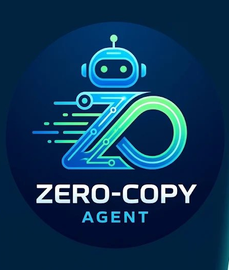
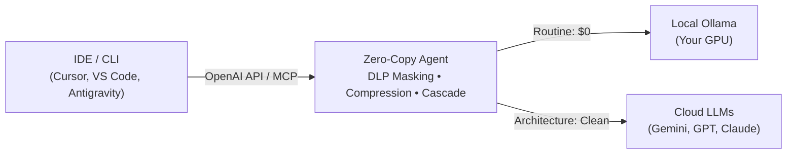

<div align="center">

<br/>

# Zero-Copy Agent

### Local LLM gateway and cascading orchestrator for code editors. Saves tokens, strips secrets, and connects to your IDE in one click.

[](https://github.com/solyanni4/zero-copy-agent/releases/latest)
[](https://opensource.org/licenses/MIT)
[](#)
[](#)
[](#)

[Русская версия](README.md) • **English Guide** • [Roadmap](ROADMAP.md) • [Control Center (Local)](http://127.0.0.1:8000/)

</div>

---

> **In plain English:**  
> When you code or brainstorm in **VS Code**, **Cursor**, **Windsurf**, or **Antigravity**, commercial AI APIs burn through your budget with each prompt. Meanwhile, database credentials, internal IPs, and API keys from `.env` can easily leak into remote clouds.  
> **Zero-Copy Agent** runs locally on your PC or home server: it catches outgoing requests before they hit the wire, masks all secrets, compresses bulky context, and offloads boilerplate coding to your local GPU (via Ollama), saving expensive cloud flagships only for complex architectural reasoning.



---

## Why Use It

| Default Setup | With Zero-Copy Agent |
| :--- | :--- |
| API bills grow even on trivial refactoring and test generation | **40–70% savings**: context is compressed, and draft code runs free on your local GPU |
| Risk of accidentally leaking `.env`, DB credentials, or private IPs | **Local secret masking**: credentials are automatically swapped for tokens before sending and restored in the code |
| One model for everything — either too expensive or not smart enough | **Smart cascade (`cascade:architect`)**: flagship model plans, fast local model writes the code |
| Manual JSON editing for each editor with a risk of breaking config | **One-click IDE setup**: automatically discovers editors, configures ports, and backs up settings |
| Opaque quotas and unexpected rate limits | **Transparent control center**: live dollar savings counter, RPM/TPM tracking, and account rotation |

---

## Key Capabilities

### Cascade Pipeline with Local Quality Gate
In `cascade:architect` mode, every request goes through a closed verification loop:
1. **Architect Planning:** A high-tier cloud model produces an architectural plan and function signatures.
2. **Local Implementation:** A fast local model on your GPU generates draft implementation.
3. **Local Hard Gate:** The agent locally parses the AST and checks syntax. If errors are detected, it re-prompts the local model (up to 2 rework cycles) without consuming cloud tokens.
4. **Architect Audit:** The cloud model reviews only the final diff, rather than the entire code payload.

### Secret Masking and Air-Gap Isolation
Before any prompt leaves your machine, the built-in scanner detects:
* API keys (`sk-...`, `AIza...`, `ghp_...`);
* database connection strings (`postgres://...`, `mongodb://...`);
* private IP addresses (`192.168.*`, `10.*`, `172.16.*`);
* authentication tokens and passwords.

Secrets are replaced with temporary tokens like `__SEC_01_KEY__`. The model generates code with these tokens, and the gateway restores the original secrets before showing the response in your editor.  
Enabling the **Air-Gap** toggle completely blocks all outgoing network traffic, restricting execution strictly to local Ollama.

### Quota Mesh and Rate Limit Protection
The gateway monitors RPM and TPM consumption across all configured accounts. When an API key approaches its threshold, the agent routes subsequent calls to a secondary account, avoiding `429 Too Many Requests` interruptions.

### Native Model Context Protocol (MCP) Support
Beyond its OpenAI-compatible endpoint (`/v1/chat/completions`), Zero-Copy Agent acts as a native MCP server via SSE (`/sse`) and JSON-RPC (`/mcp`). This allows seamless tool usage inside Google Antigravity, Claude Desktop, and Cursor.

---

## Quick Start

### Option 1. One-line terminal installation (Recommended)
The installer verifies Python, creates an isolated virtual environment, and boots the gateway:

**Windows (PowerShell):**
```powershell
irm https://raw.githubusercontent.com/solyanni4/zero-copy-agent/main/install.ps1 | iex
```

**Linux / macOS:**
```bash
curl -sSL https://raw.githubusercontent.com/solyanni4/zero-copy-agent/main/install.sh | bash
```

### Option 2. Standalone desktop application
Download `zero-copy-agent.exe` (Windows) or `zero-copy-agent-linux-x64` (Linux) from the [Releases](https://github.com/solyanni4/zero-copy-agent/releases/latest) page.  
It runs as a standard Windows app: opens a clean native window, minimizes to the system tray, and does not require an open terminal window.

### Option 3. Docker (Homelab and servers)
```bash
git clone https://github.com/solyanni4/zero-copy-agent.git
cd zero-copy-agent
docker compose up -d
```

---

## Getting Started

1. Launch the agent and open the local control center: **[http://127.0.0.1:8000/](http://127.0.0.1:8000/)**.
2. Go to the **"Интеграции IDE"** (IDE Integrations) tab and click **"Подключить"** (Connect) next to your editor:
   * **Google Antigravity** (MCP server and CLI configs);
   * **Cursor** (MCP SSE);
   * **VS Code** (Continue extension setup);
   * **Windsurf** (Codeium MCP);
   * **Claude Desktop** (MCP tool configuration).
3. The previous configuration is automatically backed up. You can revert changes anytime using the **"Откатить бэкап"** button.
4. Select your preferred model route in your editor's chat and code as usual.

### Available routing targets
* `cascade:architect` — two-stage cascade with local AST syntax gate and audit.
* `tier:local-fast` — local GPU code generation via Ollama at zero token cost.
* `gemini-4-neon` / `gpt-4o` — direct connection to flagship models for complex architectural queries.

---

## Data Privacy

* All parsing, DLP masking, and AST checks run exclusively on your machine (`127.0.0.1`).
* Request telemetry and redaction logs are stored in a local SQLite WAL database and never sent to external telemetry endpoints.
* The control center provides transparent before-and-after token counters and calculated USD savings.

---

## Contributing

Found a bug or have an optimization idea?
* Open an [Issue on GitHub](https://github.com/solyanni4/zero-copy-agent/issues) with details.
* If this tool helped reduce your API bills, consider starring ⭐ the repository — it helps the project grow.

---

## License

Open-source under the **MIT** license.  
Author: **Sergey Solyannikov ([Solyanni4](https://github.com/solyanni4))**
