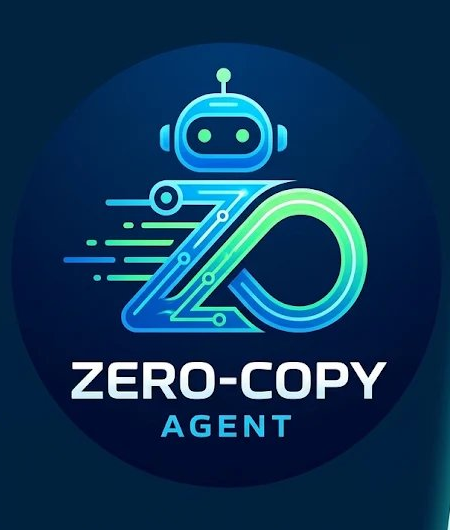

<div align="center">

<br/>

# zero-copy-agent Desktop Edition

**Автономное приложение в системном трее для Windows и Linux**  
*Подключайте ваши существующие веб-подписки (Gemini Advanced, ChatGPT Plus, Claude Pro) напрямую к любимым редакторам кода (VS Code, Cursor, Aider, Cline) — БЕЗ терминалов, БЕЗ установки Python и БЕЗ оплаты за токены API.*

[](https://github.com/solyanni4/zero-copy-agent/releases/latest)
[](#)
[](https://opensource.org/licenses/MIT)

---

### [Скачать актуальную версию (GitHub Releases)](https://github.com/solyanni4/zero-copy-agent/releases/latest)

| Платформа | Файл для загрузки | Размер | Ссылка |
| :--- | :--- | :--- | :--- |
| **Windows 10 / 11 (x64)** | `zero-copy-agent-windows-x64.exe` | ~67 МБ | [**Скачать .exe**](https://github.com/solyanni4/zero-copy-agent/releases/latest/download/zero-copy-agent-windows-x64.exe) |
| **Linux (Ubuntu / Debian / Arch)** | `zero-copy-agent-linux-x64` | ~97 МБ | [**Скачать бинарник**](https://github.com/solyanni4/zero-copy-agent/releases/latest/download/zero-copy-agent-linux-x64) |

</div>

---

## Быстрый старт (За 3 простых шага)

### Шаг 1. Запуск приложения
* **На Windows:** Просто дважды кликните по скачанному файлу `zero-copy-agent-windows-x64.exe`.
* **На Linux:** Сделайте файл исполняемым и запустите:
  ```bash
  chmod +x zero-copy-agent-linux-x64
  ./zero-copy-agent-linux-x64
  ```
В системном трее (в правом нижнем углу Windows возле часов) появится иконка **zero-copy-agent**.

---

### Шаг 2. Разовая авторизация в вашей подписке
1. Нажмите **правой кнопкой мыши** по иконке в трее.
2. Выберите нужную подписку:
   * **«Войти в Gemini Advanced»**
   * **«Войти в ChatGPT Plus»**
   * **«Войти в Claude Pro»**
3. Откроется доверенное окно браузера с защитой от антибот-проверок.
4. Войдите в свой обычный аккаунт Google / OpenAI / Anthropic (поддерживаются любые методы: 2FA, SMS, Passkeys).
5. Когда в браузере откроется интерфейс чата — нажмите **«ОК»** в появившемся системном окне. Сессия сохранена в зашифрованном локальном профиле!

---

### Шаг 3. Подключение к вашей IDE

Шлюз эмулирует стандартный OpenAI API по локальному адресу **`http://127.0.0.1:8000/v1`**. Нажмите в трее **«Скопировать API URL»** для быстрой вставки.

#### Вариант А: Visual Studio Code + расширение Continue (Рекомендуется!)

Если вы настраиваете расширение **Continue** впервые:

* **Способ 1. Через файл конфигурации в 1 клик (Самый простой и надежный):**
  1. В VS Code нажмите комбинацию **`Ctrl + L`**, чтобы открыть панель Continue.
  2. В правом верхнем углу панели нажмите иконку шестеренки (или кликните на синюю ссылку `config file` внизу окна добавления модели).
  3. Откроется файл конфигурации `~/.continue/config.yaml`. Вставьте в него блок со схемой Continue 2.0:

  ```yaml
  name: Zero-Copy Config
  version: 1.0.0
  schema: v1

  models:
    - name: Gemini Advanced (Zero-Copy)
      provider: openai
      model: gemini-advanced
      apiBase: http://127.0.0.1:8000/v1
      apiKey: sk-zero-copy
      roles:
        - chat
        - edit

    - name: ChatGPT Plus (Zero-Copy)
      provider: openai
      model: gpt-4o
      apiBase: http://127.0.0.1:8000/v1
      apiKey: sk-zero-copy
      roles:
        - chat
        - edit

    - name: Claude 3.7 Sonnet (Zero-Copy)
      provider: openai
      model: claude-3-7-sonnet
      apiBase: http://127.0.0.1:8000/v1
      apiKey: sk-zero-copy
      roles:
        - chat
        - edit
  ```
  4. Сохраните файл (**Ctrl + S**) и перезагрузите окно VS Code (**Ctrl + Shift + P** -> `Developer: Reload Window`).
  5. В панели Continue в выпадающем списке выбора моделей выберите **`Gemini Advanced (Zero-Copy)`** и пишите код!

* **Способ 2. Автоматически в 1 команду через PowerShell:**
  Просто выполните в терминале PowerShell:
  ```powershell
  irm https://raw.githubusercontent.com/solyanni4/zero-copy-agent/main/setup_vscode.ps1 | iex
  ```
  Скрипт автоматически установит расширение Continue и сформирует правильный `config.yaml`.

* **Способ 3. Через графическую форму «+ Add Chat model»:**
  1. В выпадающем меню выбора моделей нажмите **`+ Add Chat model`**.
  2. В поле **Provider** выберите **OpenAI Compatible** (или кликните `Click here to view the full list` -> `OpenAI Compatible`).  
     *(Внимание: Не выбирайте «Google Gemini», так как шлюз работает по универсальному протоколу OpenAI).*
  3. Заполните поля:
     * **Model Name:** `Gemini Advanced (Zero-Copy)`
     * **Model:** `gemini-advanced`
     * **Base URL:** `http://127.0.0.1:8000/v1`
     * **API Key:** `sk-zero-copy`
  4. Нажмите **Connect**.

---

#### Вариант Б: Cursor IDE
1. Откройте `Settings` (`Ctrl + Shift + J`) -> раздел **`Models`** -> блок **`OpenAI API Key`**.
2. Включите галочку **`Override OpenAI Base URL`** и укажите адрес:
   ```text
   http://127.0.0.1:8000/v1
   ```
3. В поле **OpenAI API Key** введите: `sk-zero-copy` *(или любой текст)*.
4. В списке моделей добавьте нужные идентификаторы:
   * `gemini-advanced`
   * `gpt-4o`
   * `claude-3-7-sonnet`
   * `cascade:architect` (каскадное проектирование)

---

#### Вариант В: Cline / Roo Code / Aider
* **Provider:** `OpenAI Compatible`
* **Base URL:** `http://127.0.0.1:8000/v1`
* **API Key:** `sk-zero-copy`
* **Model ID:** `gemini-advanced`

---

#### Вариант Г: Google Antigravity & Cursor (через Model Context Protocol / MCP)
Шлюз содержит нативный **MCP SSE-сервер**, позволяющий вызывать инструменты и каскад моделей напрямую через агентов:
* **Transport:** `sse`
* **Server URL:** `http://127.0.0.1:8000/sse`
* **Конфигурация `mcp_config.json`:**
  ```json
  {
    "mcpServers": {
      "zero-copy-agent": {
        "url": "http://127.0.0.1:8000/sse"
      }
    }
  }
  ```
* **Доступные инструменты:** `cascade_architect`, `local_gpu_code`, `gemini_deep_analysis`, `get_token_savings`, `compress_code_context`.

---

## Возможности Desktop Edition

* **Фоновая работа без консольных окон:** Приложение аккуратно сидит в системном трее, не занимает панель задач и не показывает черные окна терминала.
* **Защита от протухания сессий (Keep-Alive Daemon):** Фоновый демон каждые 90 минут делает легкий heartbeat к веб-сервисам, благодаря чему ваши cookie не сбрасываются даже при круглосуточной непрерывной работе (20–30+ часов).
* **Маршрутизация и прозрачность моделей:** В каждом ответе в вашей IDE выводится подтверждающая плашка:  
  `[zero-copy-agent | Gemini Advanced (Живая веб-подписка)]`
* **Диагностика в 1 клик:** Пункт контекстного меню *«Открыть лог-файл (Troubleshooting)»* мгновенно открывает журнал работы для быстрой проверки.

---

## Часто задаваемые вопросы (FAQ)

### Где сохраняются сессии и куки?
Все профили хранятся локально на вашей машине в каталоге:
* **Windows:** `%LOCALAPPDATA%\zero-copy-agent\browser_profile`
* **Linux:** `~/.config/zero-copy-agent/browser_profile`

### Безопасны ли мои данные?
Да. Приложение на 100% локальное (Local-First). Никакие ваши запросы, токены или данные учетных записей не передаются на сторонние серверы — трафик идет исключительно между вашей локальной IDE (`127.0.0.1:8000`) и официальными серверами Gemini / ChatGPT / Claude.
